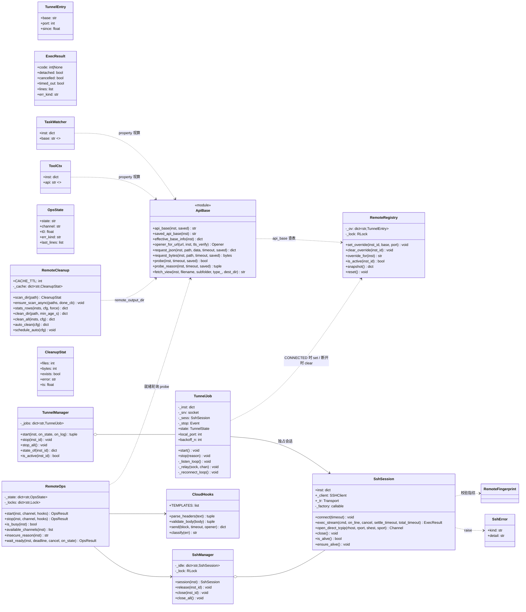
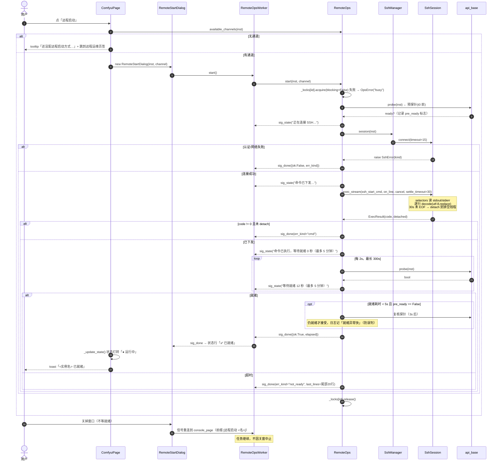
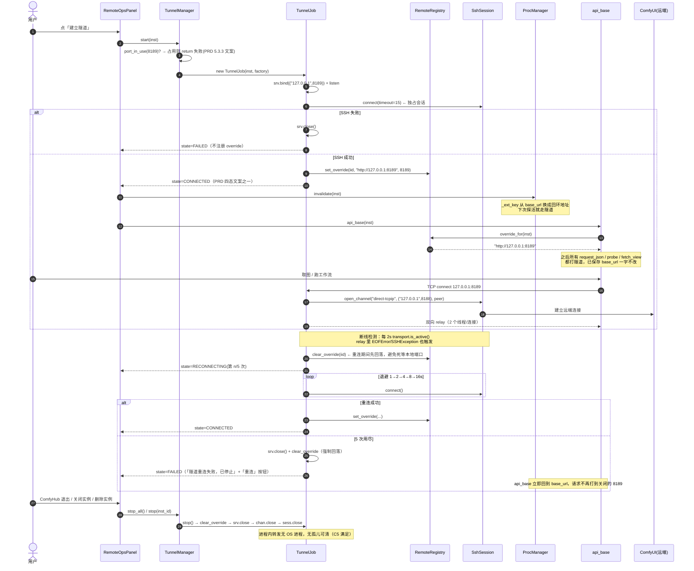
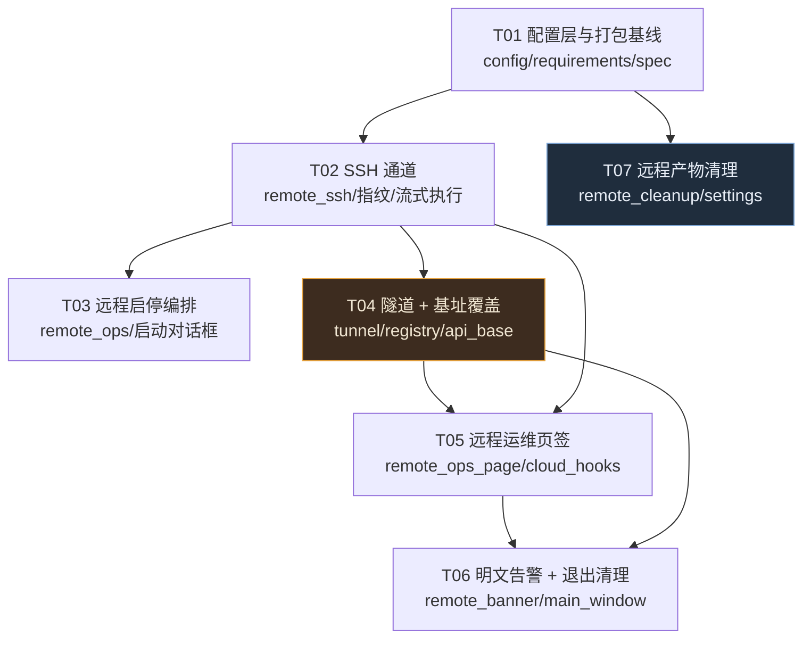

# ComfyHub v0.8.40 增量架构设计：远程实例运维

> 本文只描述 0.8.39 → 0.8.40 的增量。0.8.39 的远程连接（`api_base` / 认证 / TLS / 取图）**架构不变**，只在两处做加法：`api_base` 加「运行期基址覆盖」，`config` 加 18 个字段。
>
> 上游输入：`docs/PRD_v0.8.40_remote_ops.md`（500 行，验收标准与文案逐字引用，本文不重复抄写，只写编号）
> 已核实的既有代码：`api_base.py`(297) / `config.py`(291) / `proc_manager.py`(185) / `plugin_deps.py`(615) / `comfyui_page.py`(1808) / `env_page.py`(1629) / `secret_store.py`(88) / `i18n_en.py`(1607) / `main_window.py`(1261) / `ComfyHub.spec` / `requirements.txt` / `process.port_in_use` / `workers.py` / `plugin_banner.py`

---

## 0. 结论先行（7 条）

| # | 结论 | 影响 |
|---|---|---|
| 1 | **不动 `api_base` 的既有签名语义**。新增 keyword-only 参数 `saved=False` + 新模块 `app/remote_registry.py`（内存注册表），`api_base(inst)` 内部查表覆盖。既有 8 个调用点零改动 | 风险最低的侵入方式，可一行开关回退 |
| 2 | 只有 **2 处既有代码需要把「缓存基址」改成 property**：`ai_tools.ToolCtx.api`、`task_watch.TaskWatcher.base`。其余调用点本来就是每次现算 | 这两个内部属性一旦不改，隧道激活后 AI 助手/任务监听会一直打旧地址 |
| 3 | SSH 连接策略：**每实例两条会话** —— 「空闲会话」（测试/启停命令共用，空闲 120s 自动关）+「隧道独占会话」（隧道自己管重连，不被命令打断） | 隧道重连不会杀掉正在跑的启动命令 |
| 4 | 命令就绪判定用**状态机 + 预探针 + 快速就绪复核探针**三道闸，退出码只作为「快速失败」信号。`nohup` 不重定向导致 channel 不 EOF 时，30s 后 **detach** 到后台排空线程，继续轮询就绪 | 解决「远端本来就在跑 → 3 秒就 ready 误判」与「命令永不返回」两个坑 |
| 5 | 隧道用 paramiko `direct-tcpip` 进程内转发。**FAILED 分支必须 `clear_override` + 关监听 socket**，否则会出现「本地端口还在 listen、UI 显示运行中、实际打不通」的假活状态 | 这是本版最容易翻车的一处，单测必须覆盖 |
| 6 | 主机指纹存自己的 `<data_root>/remote/known_hosts.json`，**不读也不写** `~/.ssh/known_hosts` | 用户既有脏条目不会阻断首次连接；代价是与 ssh.exe 不共享信任（已列入待确认） |
| 7 | 打包：`ComfyHub.spec` 的 hiddenimports **不需要改**（已验证），但需给 `upx_exclude` 加 paramiko/cryptography/bcrypt 相关二进制，避免 UPX 压坏 `_rust.pyd` / `_bcrypt.pyd` | 唯一一处 spec 改动，3 行 |

---

## Part A：系统设计

## 1. 实现方案

### 1.1 核心技术难点（只列真难点，已论证过的不再重复）

| 难点 | 方案 |
|---|---|
| 隧道期间改基址但不能改配置 | 进程内单例注册表 `remote_registry`（`dict[inst_id -> base]` + `RLock`），`api_base` 查表优先；断开/失败即清条目 → 自动回落 `base_url` |
| 隧道与「运行中」判定耦合 | `proc_manager._ext_key()` 本来就用 `api_base(inst)`，隧道上下线会让缓存键自然失效；额外在状态变化时调 `procs.invalidate(inst)` 消掉最多 2s 的滞后（`EXT_TTL=2.0`） |
| 命令输出的跨线程流 | worker 线程内跑 `selectors` 读循环（`Channel` 支持 `fileno()`），逐行 `decode("utf-8","replace")` → Qt 信号排队 → UI 100ms 合帧 + 尾部 5000 行截断 |
| 5 分钟就绪轮询不能占 UI | 轮询在 worker 线程；UI 只收 `sig_state`；对话框关闭后信号改接控制台页（`sig_log` 重连到 `console_page.append_line`） |
| 清理统计可能几十 GB | daemon 线程 + 5 分钟缓存（键=目录绝对路径）+ 首次显示「统计中…」；永不阻塞 UI |
| 无 sshd 无法手测 | 全部 SSH/隧道/HTTP 传输层可注入（见 §9），用 `tests/fake_ssh.py` 的脚本化 FakeTransport 覆盖状态机 |

### 1.2 选型

| 需求 | 选型 | 理由 |
|---|---|---|
| SSH 传输 | `paramiko`（已在 `.venv_build`，PyInstaller onedir 验证过） | 密码认证唯一可行路径（`ssh.exe` 不接受 stdin 密码）；`Transport.open_channel("direct-tcpip")` 支持进程内转发 |
| 隧道转发 | paramiko `direct-tcpip` + 本地 `socket.listen` 线程 | 主理人决策 1；天然无孤儿进程，复用同一套认证与指纹 |
| HTTP（云钩子） | 标准库 `urllib` | 已有 `api_base` 的 opener/代理/TLS 设施，不引新依赖 |
| 并发模型 | 线程 + Qt 信号（不引 asyncio） | 与既有 `workers.py` / `run_pip_stream` 一致；项目无 asyncio 基础设施 |
| 架构模式 | 分层：纯逻辑模块（无 Qt） + 薄 UI | 与 `plugin_deps` / `changes_dialog` 的既有做法一致，便于离屏测试 |

**分层约束（硬规则）**：
```
UI (PySide6)  →  workers.py(QThread 包装)  →  remote_ops / tunnel / remote_ssh / cloud_hooks / remote_cleanup  (纯 Python，不 import PySide6)
                                                ↓
                                            api_base / config / secret_store
```
- `remote_ssh.py`、`tunnel.py`、`remote_ops.py`、`cloud_hooks.py`、`remote_cleanup.py`、`remote_registry.py` **禁止 import PySide6**（否则无法在离屏/无 Qt 环境跑单测）。
- `tunnel.py` / `remote_ssh.py` **禁止 import proc_manager**（避免层反转）；`procs.invalidate` 由 `main_window` 编排。

---

## 2. 文件清单

### 2.1 新增文件（10 个，约 3050 行）

| 路径 | 职责 | 行数预估 |
|---|---|---|
| `app/remote_registry.py` | 运行期基址覆盖注册表（唯一真相源，线程安全，零依赖） | 90 |
| `app/remote_fingerprint.py` | 主机指纹存储与比对（`<data_root>/remote/known_hosts.json`） | 110 |
| `app/remote_ssh.py` | SSH 会话/连接管理、认证失败分类、流式 exec、direct-tcpip 通道 | 420 |
| `app/tunnel.py` | 进程内隧道 job（监听/acceptor/双向 relay/退避重连状态机）+ `TunnelManager` 单例 | 430 |
| `app/remote_ops.py` | 远程启停编排（状态机、就绪轮询、通道选择、每实例互斥锁、明文告警判定） | 400 |
| `app/cloud_hooks.py` | 云平台模板骨架 + 请求构造/校验/发送/错误分类 | 190 |
| `app/remote_cleanup.py` | 远程产物统计（后台 + 缓存）与清理（手动/自动策略） | 300 |
| `app/ui/pages/remote_ops_page.py` | 「🛠 远程运维」页签内容（SSH / 云平台 / 隧道 三分区） | 760 |
| `app/ui/remote_start_dialog.py` | 「远程启动 — <实例名>」流式对话框（照 `PluginDepsDialog` 形态） | 250 |
| `app/ui/remote_banner.py` | http 明文告警条（照 `plugin_banner.py` 形态） | 100 |

### 2.2 修改文件（12 个，约 800 行）

| 路径 | 改动量 | 摘要 |
|---|---|---|
| `app/api_base.py` | +55 / 改 6 处 | `saved` kw-only、`saved_api_base`、`opener_for_url`、`fetch_view` 尾部挂自动清理 |
| `app/config.py` | +45 | `_SECRET_FIELDS` 加 2 项、`_INST_DEFAULTS`/`_SETTINGS_DEFAULTS` 自愈、`default_instance` 默认值、`APP_VERSION` |
| `app/proc_manager.py` | +10 | 无签名变更；仅新增 `invalidate_all()` 便捷方法（隧道批量变化时用） |
| `app/workers.py` | +180 | 新增 5 个 worker/bridge 类 |
| `app/ui/pages/comfyui_page.py` | +90 | 新页签、`_update_state` 远程分支重写、`_TRACK`/`_SAVE_LABELS`/`_snapshot` 扩字段、`_save` 明文提示、`_delete` 隧道清理 |
| `app/ui/pages/settings_page.py` | +230 | 「远程产物」分组 + 自动清理控件 + `_collect_settings` 扩字段 + MCP 片段改用 `saved_api_base` |
| `app/ui/main_window.py` | +55 | 明文告警条装配、`closeEvent` 停隧道、隧道状态桥接与 `procs.invalidate` |
| `app/ui/theme.py` | +25 | `#RemoteBanner` QSS（深/浅两套） |
| `app/ui/pages/console_page.py` | +1/-1 | `_SELF_PREFIX` 正则加 `远程`/`隧道` 前缀（只影响着色） |
| `app/ai_tools.py` | +6/-1 | `ToolCtx.api` 实例属性 → property |
| `app/task_watch.py` | +5/-1 | `TaskWatcher.base` 实例属性 → property |
| `app/i18n_en.py` | +~115 | 全部新增文案（每个任务各自补自己那批） |
| `requirements.txt` | +1 | `paramiko>=5.1.0` |
| `packaging/ComfyHub.spec` | +3 | `upx_exclude` |

### 2.3 新增测试（5 个）

`tests/fake_ssh.py`（共享桩，~220 行）、`tests/test_remote_config_v084.py`、`tests/test_remote_ssh.py`、`tests/test_remote_ops_state.py`、`tests/test_tunnel_registry.py`、`tests/test_remote_cleanup.py`

---

## 3. 数据结构与接口

### 3.1 类图（新增 + 被改动的类）



### 3.2 新增配置字段（持久化位置：`config.json`）

**实例级 `instances[]`（13 个，PRD §6 原样，加约束）**

| 字段 | 类型 | 默认 | 约束/清洗 |
|---|---|---|---|
| `ssh_host` | str | `""` | strip |
| `ssh_port` | int | `22` | clamp 1–65535 |
| `ssh_user` | str | `""` | strip |
| `ssh_auth` | str | `"password"` | ∈ {`password`,`key`} |
| `ssh_password` | str | `""` | **DPAPI**（进 `_SECRET_FIELDS`） |
| `ssh_key_path` | str | `""` | strip |
| `ssh_key_passphrase` | str | `""` | **DPAPI**（进 `_SECRET_FIELDS`） |
| `ssh_start_cmd` | str | `cd ~/ComfyUI && nohup python main.py --listen 0.0.0.0 --port 8188 > ~/comfyui.log 2>&1 &` | 空值被 `_save` 拦下（A4） |
| `ssh_stop_cmd` | str | `pkill -f "main.py --listen" \|\| true` | 同上 |
| `ssh_host_fingerprint` | str | `""` | 由 `remote_fingerprint` 写（`SHA256:...`）；空=未记录 |
| `cloud_start` / `cloud_stop` | dict | `{}` | `{url,method,headers,body}`；`url` 空 = 通道未配 |
| `cloud_start_timeout_s` | int | `300` | 本版固定 300，不暴露 UI |
| `tunnel_local_port` | int | `8189` | clamp 1024–65535 |
| `tunnel_remote_host` | str | `"127.0.0.1"` | strip |
| `tunnel_remote_port` | int | `8188` | clamp 1–65535 |
| `insecure_warn_muted` | bool | `False` | — |
| `last_ops_channel` | str | `"ssh"` | ∈ {`ssh`,`cloud`} |

**全局 `settings`（5 个）**

| 字段 | 类型 | 默认 | 约束 |
|---|---|---|---|
| `remote_cleanup_enabled` | bool | `False` | — |
| `remote_cleanup_policy` | str | `"days"` | ∈ {`days`,`size`} |
| `remote_cleanup_days` | int | `30` | clamp 1–365 |
| `remote_cleanup_max_gb` | int | `10` | clamp 1–500 |
| `remote_output_dir` | str | `""` | 0.8.39 已有，不改 |

**内存态（不落盘）**

| 名称 | 位置 | 结构 |
|---|---|---|
| `TunnelEntry` | `remote_registry._ov` | `{inst_id: ("http://127.0.0.1:8189", port, since)}` |
| `OpsState` | `remote_ops._state` | `{inst_id: {state, channel, t0, err_kind, last_lines}}` |
| `CleanupStat` | `remote_cleanup._cache` | `{abs_dir: (ts, {files,bytes,exists,error})}` |
| 空闲 SSH 会话 | `remote_ssh._idle` | `{inst_id: SshSession}` |
| 隧道 job | `tunnel._jobs` | `{inst_id: TunnelJob}` |

**文件态**：`<data_root>/remote/known_hosts.json`
```json
{"version": 1, "hosts": {"192.168.1.20:22": {"type": "ssh-ed25519",
  "fingerprint": "SHA256:AbCd...", "first_seen": "2026-12-01T10:00:00Z",
  "last_seen": "2026-12-02T09:11:00Z"}}}
```
- 键 = `host:port`（同一台机器不同端口视为不同目标）；`data_root()` 走 `app/paths.py`（便携模式自动落到程序目录）
- 写入：`tmp + os.replace` 原子写；文件损坏 → 当作空表（下次连接重新记录），不崩

### 3.3 错误类型（跨文件唯一约定：`kind` 是稳定枚举，UI 只按 kind 查文案）

| 类 | 模块 | `kind` 取值 | 对应 PRD 文案 |
|---|---|---|---|
| `SshError` | `remote_ssh` | `unreachable` | 5.1.3 E1 |
| | | `auth_password` | E2 |
| | | `auth_passphrase` | E2p |
| | | `auth_key` | E2k |
| | | `key_missing` | E2b（含 `.ppk` 提示） |
| | | `fingerprint` | E5 |
| | | `sudo` | E6 |
| | | `timeout` / `unknown` | 兜底（E1 变体） |
| `ExecResult.err_kind` | `remote_ssh` | `cmd` | E3 |
| `HookError.kind` | `cloud_hooks` | `url_invalid` / `http` / `network` / `timeout` | 5.2.3 第 1–4 条 |
| `OpsError.kind` | `remote_ops` | `not_ready` / `still_reachable` / `no_channel` / `busy` / `cancelled` | E4 / 停止后仍可达 / A5 tooltip / 边界#7 |

---

## 4. 文件级改动清单（既有签名改动标 🔴）

### 4.1 `app/api_base.py`

| 改动 | 内容 |
|---|---|
| 🔴 **改签名（kw-only，默认保持旧行为）** | `def api_base(inst: dict, *, saved: bool = False) -> str` |
| 🔴 **改签名（kw-only）** | `def request_json(inst, path, data=None, timeout=30, *, saved=False) -> dict` |
| 🔴 **改签名（kw-only）** | `def request_bytes(inst, path, timeout=60, *, saved=False) -> bytes` |
| 🔴 **改签名（kw-only）** | `def probe(inst, timeout=4, *, saved=False) -> bool` |
| 🔴 **改签名（kw-only）** | `def probe_reason(inst, timeout=4, *, saved=False) -> tuple` |
| 🔴 **改私有签名（kw-only）** | `def _opener(inst: dict, *, saved: bool = False)` |
| 新增 | `def saved_api_base(inst: dict) -> str`（= `api_base(inst, saved=True)`） |
| 新增 | `def effective_base_info(inst: dict) -> dict` → `{"base","saved","via_tunnel","is_loopback","is_insecure"}`（告警条/状态灯/诊断都用它） |
| 新增 | `def opener_for_url(url: str, inst: dict|None = None, *, tls_verify: bool = True)`（云钩子按「URL 自身是否回环」决定代理，PRD B5） |
| 改函数体 | `api_base()`：remote 分支先查 `remote_registry.override_for(inst)`（**包 try/except，异常一律返回 "" 走回落**） |
| 改函数体 | `probe()` / `request_json` / `_opener`：把 `saved` 透传下去 |
| 改函数体 | `fetch_view()`：末尾 `try: remote_cleanup.schedule_auto() except: pass`（签名不变） |

**🔴 影响面（逐条核实过，全部无破坏）**

| 调用点 | 形式 | 影响 |
|---|---|---|
| `ai_tools.py:100` `apib.request_json(ctx.inst, path, data, timeout=timeout)` | 位置参数 | 无（`saved` 默认 False） |
| `ai_tools.py:54, 166` `api_base(...)` | 位置参数 | 无 |
| `batch_runner.py:28` `api_base(inst)`；`:38/:47` `open_url(...)` | 位置参数 | 无（`open_url` 签名完全不变） |
| `health_check.py:44` `request_json(inst, "/object_info", timeout=...)` | 位置参数 | 无 |
| `ui2api.py:73` `request_json(inst, '/object_info', timeout=...)` | 位置参数 | 无 |
| `proc_manager.py:117/159` `api_base(inst)` | 位置参数 | 无 |
| `cli.py:77/91` `probe(inst, timeout=...)` | 位置参数 | 无 |
| `comfyui_page.py:1308` `probe_reason(inst, timeout=8)` | 位置参数 | 无；**唯一行为变化点**：`_test_remote` 改为 `probe_reason(inst, timeout=8, saved=True)`（隧道开着时「测试连接」测的是用户填的真地址，不是隧道） |
| `settings_page.py:78` `api_base(inst)` | 位置参数 | 改为 `saved_api_base(inst)`（MCP 片段不该导出临时隧道端口） |
| `ai_page.py:2678` `api_base(inst)` | 位置参数 | 无（显示当前生效地址，隧道时应显示回环，符合直觉） |

### 4.2 `app/ai_tools.py` 🔴

| 改动 | 内容 |
|---|---|
| 🔴 `ToolCtx.__init__:54` | 删除 `self.api = apib.api_base(...) or fallback` 赋值 |
| 新增 | `@property def api(self) -> str:` 现算 `apib.api_base(self.inst) or f"http://127.0.0.1:{port}"` |

**影响面**：`ToolCtx.api` 从可写实例属性变为只读 property。经 grep 确认：全仓写入点仅 `__init__:54` 一处，读取点仅 `:477`、`:815`（两处都是 `fetch_obj_info(ctx.api, inst=ctx.inst)`，而 `fetch_obj_info` 一旦收到 `inst` 就忽略 URL 参数 → 行为不变）。**风险：低**；回归靠既有 `test_ai_*.py`。
**不改的后果**：隧道激活后 `ctx.api` 仍是旧 `base_url`，AI 助手页右侧「当前地址」显示错、且任何依赖 `ctx.api` 的新代码会绕过隧道。

### 4.3 `app/task_watch.py` 🔴

| 改动 | 内容 |
|---|---|
| 🔴 `TaskWatcher.__init__:50-53` | 删除 `self.base = ...` 赋值，只保留 `self.inst` / `self._fallback` |
| 新增 | `@property def base(self) -> str:` 现算 `apib.api_base(self.inst) or self._fallback`（`inst is None` 时返回 `_fallback`） |

**影响面**：读取点仅 `:66`、`:71`、`:87`（每 2 秒一拍现取）。**行为改善**：隧道上线后监听自动改走隧道，不用重启 watcher。
**风险：低**；回归靠 `test_task_notify.py`。

### 4.4 `app/config.py`

| 改动 | 内容 |
|---|---|
| 改 | `APP_VERSION = "0.8.40"` |
| 🔴 改常量 | `_SECRET_FIELDS = ("auth_value", "auth_pass", "ssh_password", "ssh_key_passphrase")` → `_unprotect_instances` / `save_config` 自动覆盖（无需其他改动） |
| 新增 | `_INST_DEFAULTS: dict`（§3.2 的 13+1 字段）与 `_CLAMPS: dict` |
| 新增 | `_SETTINGS_DEFAULTS: dict`（§3.2 全局 4 字段） |
| 改 | `_sanitize_instances()`：在既有的 `("comfyui_path",""),("python_path",""),("port",8188)` 循环后追加 `for k,v in _INST_DEFAULTS.items(): if k not in inst: inst[k]=v; changed=True`，再做 `_CLAMPS` 归一 |
| 新增 | `_sanitize_settings(cfg)`（同法补 `settings`），在 `load_config()` 末尾调一次 |
| 改 | `default_instance()`：把 `_INST_DEFAULTS` 的 `ssh_start_cmd` / `ssh_stop_cmd` / `tunnel_*` / `cloud_*` 写进默认实例（新实例直接预填，满足 A4） |

注意：老配置首次加载会因补默认字段触发一次 `save_config`（`_sanitize_instances` 既有行为），符合 PRD §6「老配置自愈，不需要用户重新保存」。**`cloud_start`/`cloud_stop` 是 dict，深拷贝默认值，禁止共享同一对象引用。**

### 4.5 `app/proc_manager.py`

| 改动 | 内容 |
|---|---|
| 新增 | `def invalidate_all(self)`（清 `_ext_cache` / `_ext_pending`；隧道批量上下线用） |

无签名变更。`_ext_key()` 与 `web_url()` **不改**（已经过 `api_base`，天然隧道感知）。

### 4.6 `app/workers.py`

新增（沿用 `swap_worker` / `wait_all` 生命周期三原则）：

| 类 | 信号 | 说明 |
|---|---|---|
| `SshTestWorker(QThread)` | `sig_done(bool, str)` | 调 `remote_ssh` 验证连通+认证，`kind → 文案` 在 UI 侧做 |
| `RemoteOpsWorker(QThread)` | `sig_log(str)` / `sig_state(str)` / `sig_done(dict)` | 包装 `remote_ops.start/stop`；`cancel()` 置 `threading.Event` |
| `TunnelBridge(QObject)` | `sig_state(str, str)` / `sig_log(str)` | 把 `TunnelJob` 的线程内回调转成 Qt 排队信号 |
| `CleanupStatsWorker(QThread)` | `sig_done(dict)` | 后台统计 |
| `CleanupWorker(QThread)` | `sig_done(dict)` | 后台清理（含全部清空） |

### 4.7 `app/ui/pages/comfyui_page.py`

| 改动 | 位置 | 内容 |
|---|---|---|
| 新增 | `_build()` 末尾 | `self.remote_ops = RemoteOpsPanel(self)` 作为第 4 个页签 `🛠 远程运维`（index 3，**初始 `setTabVisible(3, False)`**） |
| 改 | `_apply_kind_visibility()` | 现有 `for idx in (1,2): setTabVisible(idx, not remote)` 之后追加 `setTabVisible(3, remote)`；`remote` 分支不再无条件 `setCurrentIndex(0)`（若当前在 3 则保持） |
| 改 | `load_current()` | 远程分支末尾 `self.remote_ops.load(inst)`；无实例时 `self.remote_ops.clear()` |
| 改 | `_snapshot()` | 末尾合并 `d.update(self.remote_ops.collect())`（返回 14 个新键） |
| 改 | `_TRACK` | 追加 §3.2 的 14 个可编辑字段（`cloud_start_timeout_s` 除外，它不暴露给用户） |
| 改 | `_SAVE_LABELS` | 追加 14 个中文标签（进改动确认框） |
| 改 | `_SAVE_EMPTY_TEXT` | 追加 `ssh_password`/`ssh_key_passphrase` → `"未填写"`；`cloud_start`/`cloud_stop` → `"未配置"` |
| 改 | `_save()` | ① `new["kind"]=="remote"` 分支追加：`ssh_password`/`ssh_key_passphrase` 留空 = 保持原值（与 `auth_value` 同规则）② 校验 `ssh_start_cmd` / `ssh_stop_cmd` 不能为空（A4）③ 写盘后、`save_config()` 前插入 **D2 明文告警模态**（`remote_ops.insecure_reason(new_inst)` 非空且未 muted 时） |
| 改 | 🔴 `_update_state()`（1165-1191） | **远程分支整段重写**：见 §4.7.1 |
| 改 | `start()` / `stop()` | 开头判 `remote`：转 `self._remote_start()` / `self._remote_stop()`；**本机路径完全不动**（PRD「本机实例完全沿用 0.8.39」） |
| 新增 | `_remote_start()` / `_remote_stop()` | 通道预检 → `RemoteStartDialog` → `RemoteOpsWorker` |
| 改 | `_test_remote()` | `probe_reason(..., saved=True)` |
| 改 | `_delete()` | 「仅移出管理」分支：`tunnel_manager.stop(inst_id)` + `remote_registry.clear_override(inst_id)` |
| 改 | `open_browser()` | 不改（走 `procs.web_url()` → 已隧道感知） |

#### 4.7.1 `_update_state()` 远程分支重写（PRD 5.1.2 按钮态规则）

| 实例情况 | 启动按钮 | 停止按钮 | 状态灯 |
|---|---|---|---|
| 远程 + 有通道 + 未运行 | 可点「远程启动」 | 禁用 | `未运行` |
| 远程 + 有通道 + 运行中 | 禁用 | 可点「远程停止」 | `● 运行中`（隧道时 `● 运行中（经隧道）`） |
| 远程 + 无通道 | 禁用，tooltip = PRD A5 原文 | 禁用 | `未运行` |
| 远程 + 启动中 | 文字「启动中…」禁用 | 可点（中断） | `● 启动中…` |
| 远程 + 停止中 | 禁用 | 禁用 | `● 停止中…` |
| 本机 | 保持 0.8.39 逻辑 | 保持 | 保持 |

### 4.8 `app/ui/pages/settings_page.py`

| 改动 | 内容 |
|---|---|
| 新增 | `_build()` 中 `root.addWidget(g_dir)` 之后插入「远程产物」`QGroupBox`（PRD 5.5.1 四列表格 + 底部按钮行 + 自动清理控件） |
| 新增 | `_remote_table()` / `_refresh_remote_stats(force=False)` / `_remote_clean_one(name, path)` / `_remote_clean_all()` / `_on_cleanup_done(res)` |
| 改 | `_collect_settings()` 追加 `remote_cleanup_enabled` / `remote_cleanup_policy` / `remote_cleanup_days` / `remote_cleanup_max_gb`（4 个，`remote_output_dir` 0.8.39 已有则不在此页暴露） |
| 改 | `on_show()` 追加 `self._refresh_remote_stats()`（走 5 分钟缓存，不重复扫） |
| 改 | `_mcp_snippet()` 里 `apib.api_base(inst)` → `apib.saved_api_base(inst)` |
| 新增 | 「网络」分组底部「恢复明文告警」按钮（D4，P1）→ 清空所有实例 `insecure_warn_muted` 并 `save_config` |

### 4.9 `app/ui/main_window.py`

| 改动 | 内容 |
|---|---|
| 新增 | `__init__` 里装配 `self.remote_banner = RemoteBanner(self)`，插在 `plugin_banner` 之后（`right.addWidget`） |
| 新增 | `self.tunnel_manager = tunnel.TunnelManager()` + `self.tunnel_bridge = TunnelBridge()`，连接 `sig_state` → `_on_tunnel_state` |
| 新增 | `_on_tunnel_state(iid, state, text)`：`procs.invalidate(inst)` → `comfyui_page._update_state()` / `remote_ops.load(...)` 状态行刷新 → `console_page.append_line("[隧道 …]")` |
| 新增 | `_on_insecure_warn(inst)`：同实例同会话只显示一次（`self._insecure_shown: set`） |
| 改 | `closeEvent()` | `self.procs.stop_all()` 之后追加 `self.tunnel_manager.stop_all()`（在 `_stop_watchers()` 之前），无异常抛出 |
| 改 | `_on_inst_changed()` | 切实例不动隧道（PRD 边界 #20），只调 `comfyui_page._update_state()` |
| 改 | `_sync_instances()` | 不变 |

### 4.10 其他小改

| 文件 | 改动 |
|---|---|
| `app/ui/pages/console_page.py:30` | `_SELF_PREFIX = re.compile(r"^\[(ComfyHub\|计划\|插件\|工具\|救援\|远程[^\]]*\|隧道[^\]]*)\]")`（只影响着色，把 `[远程启动 xx]` 归到「本软件操作」橙色） |
| `app/ui/theme.py` | 新增 `#RemoteBanner`（深色 `#3d3418/#e8c46a`，浅色走 `_LIGHT_MAP` 映射），与 `#PluginBanner` 并列；`fit_all_tables` 无需改（新表自动覆盖） |
| `requirements.txt` | `paramiko>=5.1.0` |
| `packaging/ComfyHub.spec` | `upx_exclude=[]` → `upx_exclude=['_rust*.pyd', '*.pyd']` 的**保守版**：`['_rust.pyd', '_bcrypt.pyd', 'libcrypto-*.dll']`（见 §8.3） |

---

## 5. 关键调用流程

### 5.1 SSH 启动实例（含就绪轮询与三道闸）



**状态机**

```
idle ──start──▶ connecting ──ok──▶ executing ──dispatched──▶ waiting_ready ──ok──▶ ready
                    │                  │                          │
                    └──SshError──────▶ └──code!=0──────────────▶ └──300s────────▶ failed(kind)
                                                                   └──cancel────▶ cancelled
idle ──stop──▶ stopping ──probe False──▶ idle
                    └──probe True(60s)──▶ failed("still_reachable")
```

### 5.2 建立隧道并使用（含 override 生效与回落）



### 5.3 自动清理（取图成功后触发）

```mermaid
sequenceDiagram
    autonumber
    participant AB as api_base.fetch_view
    participant RC as RemoteCleanup
    participant T as daemon 线程
    participant FS as 本地缓存目录
    participant CP as ConsolePage

    AB->>AB: 下载 /view → os.replace(tmp, target)
    AB->>RC: schedule_auto()   ← 一行，异常全吞
    RC->>RC: now - _last_auto < 600s? → return
    RC->>RC: _last_auto = now
    RC->>T: Thread(target=_auto_worker, daemon=True)
    Note over AB: UI/取图路径立即返回，不等清理
    T->>RC: load_config()（仅在后台线程读，不在热路径）
    alt remote_cleanup_enabled == False
        T-->>RC: 直接返回（默认关，PRD E4）
    else 开启
        T->>FS: os.walk(root) 收集 (path, size, mtime)
        T->>T: 跳过 mtime < 3600s（PRD E5/边界#18）<br/>跳过 *.part
        alt 策略 days（默认 30）
            T->>FS: 按 mtime 升序，删超过 30 天的
        else 策略 size（默认 10GB）
            T->>FS: 按 mtime 升序，删到总量 ≤ 10GB
        end
        T->>FS: 逐个 unlink，失败只计数（PermissionError → skipped）
        T-->>RC: {deleted, freed, skipped}
        RC->>CP: append_line("[远程清理] 自动清理：删除 n 个旧产物，释放 X")
        opt freed >= 500MB
            RC->>CP: toast「自动清理：删除 n 个旧产物，释放 X」
        end
        RC->>RC: 失效该目录统计缓存
    end
```



---

## Part B：任务分解

> **粒度说明**：本版是既有项目增量开发，5 个功能域彼此正交（SSH / 隧道 / 云钩子 / 告警 / 清理），每条任务都能**独立提交、独立验证、独立回退**，故切成 7 条而非默认的 5 条上限（主理人指示目标 6–9 条）。每条任务的验收标准全部可脚本化或可离屏复现。

### 6. 依赖包清单

```
# requirements.txt 增补（唯一新增直接依赖）
paramiko>=5.1.0        # SSH 传输；密码认证必须用它（ssh.exe 不接受 stdin 密码）

# 以下为 paramiko 的传递依赖，不写进 requirements.txt（由 pip 解析）
# cryptography>=50.0.2   # 含 Rust 扩展 _rust.pyd，PyInstaller 需校验落点
# bcrypt>=5.0.0          # _bcrypt.pyd
# pynacl>=1.6.2
```
已在 `.venv_build`（Python 3.13.14）实测：`paramiko 5.1.0 + cryptography 50.0.2 + pynacl 1.6.2 + bcrypt 5.0.0` 装好且 import 成功；最小 onedir 打包验证**无需额外 hiddenimports**，frozen exe 运行正常，产物 +12–15MB。

### 7. 任务列表

#### T01 配置层与打包基线（P0）

| 项 | 内容 |
|---|---|
| **改哪些文件** | `app/config.py`、`requirements.txt`、`packaging/ComfyHub.spec`、`tests/test_remote_config_v084.py`(新) |
| **内容** | ① `APP_VERSION → "0.8.40"` ② `_SECRET_FIELDS` 加 `ssh_password` / `ssh_key_passphrase` ③ `_INST_DEFAULTS`（14 项）+ `_CLAMPS` + `_sanitize_instances` 补齐与归一（`cloud_start/cloud_stop` 深拷贝）④ `_SETTINGS_DEFAULTS` + `_sanitize_settings` ⑤ `default_instance()` 预填启动/停止命令与隧道默认值 ⑥ `requirements.txt` 加 paramiko ⑦ `spec` 加 `upx_exclude` |
| **验收标准** | ① 拿一份 0.8.39 的真实 config.json（无任何新字段）加载后：`ssh_port==22`、`tunnel_local_port==8189`、`ssh_start_cmd` 非空、`remote_cleanup_policy=="days"`，且只落盘一次 ② `ssh_password="abc123"` 保存后 `config.json` 里是 `enc:v1:` 开头、内存里是明文（复用 `secret_store` 手测）③ `tunnel_local_port=70000` / `remote_cleanup_days=0` 被 clamp ④ 换机器解不开密文 → 字段变 `""`，不抛异常 ⑤ `pip install -r requirements.txt` 后 `import paramiko` 成功；`packaging\build_exe.bat` 能出包，`dist\ComfyHub\_internal\` 下存在 `cryptography\hazmat\bindings\_rust*.pyd` 与 `bcrypt\_bcrypt*.pyd`，双击 exe 能开窗 |
| **依赖** | —（可立即开工） |

#### T02 SSH 通道：连接、认证分类、流式执行、指纹（P0）

| 项 | 内容 |
|---|---|
| **改哪些文件** | `app/remote_ssh.py`(新 420)、`app/remote_fingerprint.py`(新 110)、`app/workers.py`(+`SshTestWorker`)、`app/i18n_en.py`、`tests/fake_ssh.py`(新 220)、`tests/test_remote_ssh.py`(新) |
| **内容** | `SshSession`（connect / exec_stream / open_direct_tcpip / close / is_alive）、`SshManager`（空闲会话池，120s 自动关，后台 30s tick）、认证五分类（E1/E2/E2p/E2k/E2b）、`sudo` 识别（E6）、指纹策略类（首次记录 / 变化拒绝）、`exec_stream` 的 `selectors` 读循环 + `settle_timeout=30s` detach、`ExecResult` |
| **验收标准** | ① `tests/test_remote_ssh.py` 全绿：五种认证失败 kind 各自命中（用 `FakeTransport` 脚本模拟）、指纹首次记录→写入 json→二次连接通过→改指纹后抛 `kind="fingerprint"` ② `exec_stream` 收到 `("delay",31)` 脚本时返回 `detached=True` 且不阻塞超过 32s ③ cancel 后 `code=None, cancelled=True` 且 channel 已 close（FakeChannel 断言 `closed`）④ 乱码输出（`b"\xff\xfe"`）不抛异常，行内是 `�` ⑤ 故意给 `~/.ssh/known_hosts` 写一条冲突项，连接**不受影响**（证明没读系统文件）⑥ UI 侧「测试 SSH」在无 sshd 本机返回 E1 文案而非 traceback |
| **依赖** | T01 |

#### T03 远程启停编排 + 启动对话框（SSH 通道，P0）

| 项 | 内容 |
|---|---|
| **改哪些文件** | `app/remote_ops.py`(新 400)、`app/ui/remote_start_dialog.py`(新 250)、`app/workers.py`(+`RemoteOpsWorker`)、`app/ui/pages/comfyui_page.py`（`_update_state` 重写 / `start`/`stop` 分支 / `_remote_start` / `_remote_stop`）、`app/i18n_en.py`、`tests/test_remote_ops_state.py`(新) |
| **内容** | 状态机（idle→connecting→executing→waiting_ready→ready/failed）、每实例互斥锁、预探针 + 快速就绪复核、停止后可达性确认、`available_channels`、四类失败 kind（E1/E2/E3/E4）+ 停止仍可达、流式对话框（关窗不中断 + 写控制台 + 5000 行截断）、按钮态表格落地 |
| **验收标准** | ① 状态机单测（注入 `probe_fn` / `now_fn` / `poll_interval=0.01`）：退出码 0 + 永不 ready → `not_ready` 且 `last_lines` 有 20 行 ② 退出码 2 → `cmd`，不进入轮询 ③ 预探针 ready → 仍执行命令，结果 `pre_ready=True`，无「启动成功」误报 ④ 就绪出现在 3s 内且预探针不 ready → 触发复核探针（断言之）⑤ 停止：`code=0` 但 probe 仍 True 超过 60s → `still_reachable` ⑥ 并发：同实例第二次 `start` 立刻返回 `busy` ⑦ 离屏：远程实例点「远程启动」弹对话框，关掉后任务继续、`console_page` 出现 `[远程启动 xx]` 行 ⑧ 本机实例行为与 0.8.39 完全一致（回归 `tests/test_ui_state.py`）⑨ 断网/错端口/错密码三种情况无 traceback 露出（X4） |
| **依赖** | T02 |

#### T04 隧道 + 运行期基址覆盖（P0，全版最高风险）

| 项 | 内容 |
|---|---|
| **改哪些文件** | `app/remote_registry.py`(新 90)、`app/tunnel.py`(新 430)、`app/api_base.py`、`app/ai_tools.py`、`app/task_watch.py`、`app/proc_manager.py`、`app/ui/pages/settings_page.py`（MCP 1 行）、`tests/test_tunnel_registry.py`(新) |
| **内容** | 注册表（RLock / set / clear / override_for / reset）；`TunnelJob`（端口预检 → bind → 独占 SSH → set_override → accept 循环 → 双向 relay → `transport.is_active()` 2s 检测 → 退避 1/2/4/8/16 → FAILED 强制清 override + 关监听）；`TunnelManager` 单例；`api_base` 加 `saved` kw + `saved_api_base` + `effective_base_info` + `opener_for_url`；`ToolCtx.api` / `TaskWatcher.base` 属性化 |
| **验收标准** | ① `test_tunnel_registry.py`：`set_override` 后 `api_base(inst)` 返回回环、`saved_api_base(inst)` 返回原 `base_url`、`inst["base_url"]` 未被改 ② `clear_override` 后 `api_base` 立即回落 ③ **FAILED 分支**：连续 5 次重连失败后断言 `registry.is_active()==False` 且本地端口可被重新 bind（无「假活」）④ 端口占用预检：先占 8189，`start()` 返回失败文案、不注册 override ⑤ 断线注入（FakeTransport 主动 EOF）→ 状态序列 `CONNECTED → RECONNECTING(1..5) → FAILED` ⑥ 退避序列实测为 `[1,2,4,8,16]`（注入 clock 断言）⑦ `ToolCtx.api` 在 `set_override` 后现算为回环地址（属性化验证）⑧ 回归 `test_ai_conn.py` / `test_task_notify.py` / `test_remote_ui.py` 全绿 |
| **依赖** | T02 |

#### T05 「🛠 远程运维」页签：三分区表单 + 云平台钩子（P0）

| 项 | 内容 |
|---|---|
| **改哪些文件** | `app/ui/pages/remote_ops_page.py`(新 760)、`app/cloud_hooks.py`(新 190)、`app/ui/pages/comfyui_page.py`（新页签装配 / `_apply_kind_visibility` / `load_current` / `_snapshot` / `_TRACK` / `_SAVE_LABELS` / `_save` 校验）、`app/ui/theme.py`、`app/i18n_en.py`、`tests/test_remote_ops_page.py`(新) |
| **内容** | SSH 分区（主机/端口/用户名/认证方式/密码/密钥/口令 + 测试 SSH + 启动命令含恢复默认 + 停止命令 + 就绪判定说明）、云平台分区（模板下拉 + 套用确认 + 开机/关机四字段 + 发请求按钮 + 灰字提示）、隧道分区（3 个数字 + 建立/断开 + 四态状态行 + 建议灰字）、通道下拉（A10，两通道都配时才出现）、表单 ↔ inst 的 `load`/`collect` |
| **验收标准** | ① 离屏：本机实例看不到第 4 个页签，切远程出现、切回消失且不留空位（A1）② 认证方式切「密码/密钥」时对应行正确显隐 ③ 新增远程实例时启动/停止命令已预填（A4）；清空启动命令后保存被拦下并提示「启动命令不能为空」 ④ 套用模板：已有内容先弹「会覆盖当前内容，继续？」；4 个模板都只含占位符骨架，无任何真实平台参数（决策 2）；灰字「模板只是骨架…」在位 ⑤ 请求体非法 JSON → 提示「请求体不是合法 JSON（第 n 行）」，不发请求（边界 #14）⑥ 请求头多行解析：`Authorization: Bearer x` → `{"Authorization":"Bearer x"}` ⑦ 四个模板的 `cloud_hooks.send` 用注入 opener 断言 URL/method/header/body 与表单一致 ⑧ 保存后 `config.json` 的 14 个新字段齐备；「保存设置」改动确认框能列出这些字段的中文名 ⑨ 英文模式下该页签无残留中文（X2，肉眼 + `tests/i18n_leftover.py`） |
| **依赖** | T02、T04 |

#### T06 http 明文告警 + 退出清理 + 主窗集成（P0）

| 项 | 内容 |
|---|---|
| **改哪些文件** | `app/ui/remote_banner.py`(新 100)、`app/ui/main_window.py`、`app/ui/pages/comfyui_page.py`（`_save` 明文模态 / `_delete` 隧道清理）、`app/remote_ops.py`(+`insecure_reason`)、`app/ui/theme.py`(+`#RemoteBanner`)、`app/ui/pages/console_page.py`（前缀正则）、`app/i18n_en.py` |
| **内容** | `insecure_reason(inst)`（用**生效基址**：隧道激活 → 回环 → 不告警）；保存时模态（可勾「不再提示这个实例」并立即落盘、不阻断保存）；连接成功时黄条（同实例同会话一次、✕ 关闭）；「恢复明文告警」按钮；`closeEvent` 停隧道；隧道状态 → `procs.invalidate` + 状态灯刷新；删除实例清隧道 |
| **验收标准** | ① `http://192.168.1.20:8188` → 保存弹模态；`https://` → 不弹；隧道激活时同一实例 → 不弹（D1）② 勾「不再提示」→ `insecure_warn_muted=true` 且**立刻**落盘，再保存不弹 ③ 设置页「恢复明文告警」清空全部实例标记 ④ 主窗黄条：同实例本会话只出现一次，✕ 可关，切换实例不串（D3）⑤ 退出 ComfyHub 后不存在任何 ssh 相关 OS 进程（进程内转发，任务管理器核对）⑥ 删除实例时该实例隧道被停、`registry` 条目清空 ⑦ 隧道建立/断开后状态灯文案追加/去掉「（经隧道）」，且 `打开网页` 指向 `http://127.0.0.1:<本地端口>` ⑧ 控制台里 `[远程启动 xx]` / `[隧道 xx]` 行按「本软件操作」色显示 |
| **依赖** | T04、T05 |

#### T07 远程产物清理：统计 / 手动清空 / 自动策略（P0）

| 项 | 内容 |
|---|---|
| **改哪些文件** | `app/remote_cleanup.py`(新 300)、`app/ui/pages/settings_page.py`（「远程产物」分组 + 自动清理控件 + `_collect_settings`）、`app/api_base.py`（`fetch_view` 一行）、`app/workers.py`(+`CleanupStatsWorker` / `CleanupWorker`)、`app/i18n_en.py`、`tests/test_remote_cleanup.py`(新) |
| **内容** | `scan_dir`（`os.walk` + 逐文件 `getsize`，失败只计数）、5 分钟缓存（键=绝对目录路径）、后台统计 + 「统计中…」、行级「打开目录/清空」、底部「全部清空/重新统计」、孤儿目录显示「（已删除的实例）<目录名>」、自动清理（days/size + 跳过 3600s 内 + 跳过 `.part` + 10 分钟节流 + ≥500MB toast）、`fetch_view` 触发点 |
| **验收标准** | ① 目录不存在 → 行显示「尚无缓存」，不报错、不显示 0 B ② 造 200 个假文件 + 一个只读文件 → `clean_dir` 返回 `deleted/skipped` 正确，只读那个 `skipped` ③ 缓存：连续两次 `stats_rows` 只有第一次扫盘（打点计数），`force=True` 强制重扫 ④ 500ms 内返回（不等扫描），UI 不卡（离屏测：`QApplication.processEvents` 期间响应）⑤ 自动清理默认关；开启后 days 策略删 31 天前的、保留 1 小时内的；size 策略删到 ≤10GB 且从最旧开始 ⑥ 10 分钟内两次 `schedule_auto` 只触发一次 ⑦ 二次确认文案与结果文案逐字含「删的是 ComfyHub 的本地副本，远端原图不受影响」（E6）⑧ 权限不足目录 → `error="目录不可写：<path>"`，自动清理跳过且只写 `app.log`，不弹窗（边界 #17） |
| **依赖** | T01（只需配置字段，可与 T02–T06 并行） |

### 8. 任务依赖图



**关键路径**：T01 → T02 → T04 → T05 → T06（5 跳）。**可并行**：T03 与 T04 同期（都只依赖 T02）；T07 与 T02–T06 完全并行。

### 9. 跨文件约定

| 项 | 约定 |
|---|---|
| **字段命名** | 实例级一律 `ssh_*` / `cloud_*` / `tunnel_*` / `last_ops_channel` / `insecure_warn_muted`；全局一律 `remote_cleanup_*`。新增实例字段必须同时出现在 `_INST_DEFAULTS`、`_TRACK`、`_SAVE_LABELS`、`_snapshot`、`remote_ops_page.collect` **五处**，缺一处就会出现「改了不保存」或「保存了不显示」 |
| **错误类型** | 只用 `SshError.kind` / `HookError.kind` / `OpsError.kind`（§3.3 枚举）。**UI 禁止匹配错误字符串**，一律 `kind → T("文案")` 映射；新增 kind 必须同时补 i18n |
| **日志前缀** | `[远程启动 <实例名>]` / `[远程停止 <实例名>]` / `[隧道 <实例名>]` / `[远程清理]`。全部经 `console_page.append_line`，并把 `console_page._SELF_PREFIX` 正则扩到 `远程[^\]]*` / `隧道[^\]]*`（否则不着色） |
| **i18n key 规则** | 键 = 源码中文原文**逐字**（含标点/emoji/全角空格）。**含动态变量的整句禁止入表**（i18n 是按整串查表，拼出来的永远查不到）→ 拆成「静态片段 + 拼接」，片段各自入表。新增文案由**各任务自己**补进 `app/i18n_en.py`，不集中到一个任务 |
| **线程规则** | `remote_ssh` / `tunnel` / `remote_ops` / `cloud_hooks` / `remote_cleanup` **禁止 import PySide6**；UI 线程只做 `emit` 与 `setText`；任何 `connect()` / `exec` / `socket.accept` / `os.walk` 大目录都不得在 UI 线程 |
| **时间基准** | 超时/退避用 `time.monotonic()`；缓存时间戳与文件 mtime 用 `time.time()`。两者不得混用 |
| **锁顺序** | `remote_ops._locks[inst_id]`（运维互斥）→ `remote_registry._lock`（短持有）→ `SshManager._lock`。禁止反向获取，禁止在持锁期间做网络 IO |
| **单实例保证** | 隧道只在 GUI 进程内存活，`app/single_instance.py` 已保证不会双开，故**无需** pid 记录与残留进程清理（C5 由「进程内转发 + 退出时 stop_all」满足） |
| **状态灯文案** | 唯一来源 `comfyui_page._update_state()`；隧道状态只通过 `effective_base_info(inst)["via_tunnel"]` 影响它，不在别处改 `lb_state` |
| **配置读取** | 纯逻辑模块（`remote_ops` / `remote_cleanup` / `cloud_hooks`）**不持有 cfg**，由调用方传入或按需 `load_config()`；`load_config()` 只在后台线程或 UI 事件里调用 |

---

## 10. 测试可注入点设计（无 sshd 也能全路径覆盖）

### 10.1 `remote_ssh` / `tunnel`

```python
SshSession(inst, *, transport_factory=None, clock=time.monotonic)
TunnelJob(inst, *, transport_factory=None, clock=time.monotonic,
          backoff=(1, 2, 4, 8, 16), probe_interval=2.0, local_port=None)  # None=沿用 inst 配置；0=OS 分配
```

`transport_factory(host, port, timeout) -> FakeTransport`。**FakeTransport 必须提供的接口**（paramiko 子集）：

| 成员 | 用途 |
|---|---|
| `connect(username=, password=, pkey=, timeout=, banner_timeout=, auth_timeout=)` | 认证分支切换 |
| `is_active() -> bool` | 隧道断线检测 |
| `is_authenticated() -> bool` | 会话复用判断 |
| `get_remote_server_key() -> PKey`（含 `.get_name()` / `.get_base64()`） | 指纹 |
| `open_session(timeout=) -> FakeChannel` | exec |
| `open_channel(kind, dest_addr, src_addr) -> FakeChannel` | direct-tcpip |
| `set_keepalive(n)` / `close()` | 生命周期 |

`FakeChannel`：`exec_command(cmd)` / `recv_ready()` / `recv(n)` / `recv_stderr_ready()` / `recv_stderr(n)` / `exit_status_ready()` / `recv_exit_status()` / `close()` / `fileno()` / `setblocking(flag)` / `closed`（断言用）。

**脚本化**：`FakeTransport(script=[("out","Starting server\n"), ("err","x"), ("delay",1.5), ("exit",0)])` 覆盖输出/延迟/退出码；`FakeTransport(auth_error=PasswordRequiredException(...))` 覆盖五类认证失败；`FakeTransport(fail_after_bytes=100)` 覆盖隧道中途断线。

### 10.2 其他注入点

| 模块 | 注入口 |
|---|---|
| `remote_ops.start/stop/wait_ready` | `probe_fn=api_base.probe`、`now_fn=time.monotonic`、`poll_interval=2.0`、`ready_timeout=300`（测试传 0.01 / 0.05） |
| `cloud_hooks.send` | `opener=None`（测试传 `lambda req: FakeResp(200, b'{}')`） |
| `remote_cleanup` | 纯文件系统 + `now_fn`；`monkeypatch api_base.remote_output_dir` |
| `remote_registry` | 模块级单例 → 每个测试用 `reset()` fixture（`conftest`-free，显式调用） |
| `comfyui_page` | 离屏 `QT_QPA_PLATFORM=offscreen` + 临时 `APPDATA`（照 `tests/test_remote_ui.py` 既有做法） |
| `secret_store` | 已有 `test_secret_store.py` 的 DPAPI 手测路径可复用 |

**禁止**：测试里出现真实网络调用、真实 `~/.ssh` 读写、真实 `paramiko.SSHClient()`（除非 `pytest.mark.manual`）。

---

## 11. 风险与回滚

| # | 风险 | 概率/影响 | 缓解 | 单独回退方式 |
|---|---|---|---|---|
| 1 | `api_base` 里查注册表抛异常 → **全仓 HTTP 全挂**（本机实例也受影响） | 低/**致命** | 注册表查询包 `try/except: return ""`；`remote_registry` 零依赖、无 IO、单 dict + RLock，几乎无抛点 | 把 `api_base` 里 override 分支用一个模块常量 `_TUNNEL_ENABLED = True` 包住 → 改 1 行恢复 0.8.39 行为，隧道功能整体失效但不影响任何其他功能 |
| 2 | 隧道 FAILED 未清 override → 「本地端口 listen 着、UI 显示运行中、实际打不通」假活 | 中/**高**（最脏的故障形态） | FAILED 分支强制 `clear_override` + `srv.close()`；RECONNECTING 期间也先 clear（回落 base_url）；单测 T04-③⑤ 断言 | 独立文件 `tunnel.py` + 注册表，直接不装配（`main_window` 不建 `TunnelManager`）即回到无隧道版本 |
| 3 | `ai_tools.ToolCtx.api` / `task_watch.TaskWatcher.base` 属性化引入回归 | 中/中 | 两者读取点已 grep 穷举（2 处 / 3 处），语义等价；既有 `test_ai_conn.py` / `test_task_notify.py` 覆盖 | 单独 commit 回退为实例属性（此时隧道激活后这两位仍走 base_url，仅损失「AI 助手显示当前地址」与「watcher 走隧道」） |
| 4 | `nohup` 未重定向 → channel 永不 EOF，启动流程假死 | 中/中 | `settle_timeout=30s` detach 到后台排空线程，主流程转就绪轮询；预填命令自带 `> ~/comfyui.log 2>&1 &` | 调大/调小 `settle_timeout`；最坏情况用户看到 E3 而非卡死 |
| 5 | 命令输出洪泛（每秒几十行） | 中/低 | 5000 行尾部截断 + 100ms 合帧刷新 + 单行 2000 字符截断 | 调 `_MAX_LINES` / `_FLUSH_MS` 常量 |
| 6 | UPX 压坏 `_rust.pyd` / `_bcrypt.pyd` → 打包版一开就 `ImportError` | 中/高（只在打包版暴露） | `spec` 加 `upx_exclude`；干净机器实测（T01 验收⑤） | `upx=False`（体积 +15~20MB，但必稳） |
| 7 | 首次连接因指纹记录失败（目录不可写）而无法连接 | 低/中 | 写盘失败 → 只在内存记并写 `app.log`，连接继续（不因记录失败阻断） | — |
| 8 | 自动清理误删正在写的 `.part` | 低/中 | 跳过 `<3600s` mtime + 跳过 `.part` 后缀 | 默认关（`remote_cleanup_enabled=False`），用户不开就完全不跑 |
| 9 | 清理统计在几十 GB 目录上耗时 | 低/中 | daemon 线程 + 5 分钟缓存 + 「统计中…」 | 用户可关掉自动清理，统计仍是只读操作 |
| 10 | 实例改名导致缓存目录变孤儿 | 已知/低 | 按 PRD 边界 #19 列成「（已删除的实例）<目录名>」可手清；本版不自动迁移（避免误删） | — |
| 11 | `read the docs` 级别的大改污染 0.8.39 远程能力 | — | T04 是唯一动既有模块行为的任务；`api_base` 的 `saved` 全部 kw-only，T07 只加一行调用 | 逐任务独立 commit，回退顺序：T06 → T05 → T04 → T03 → T02 → T07 → T01（T01 回退=删字段，旧代码忽略未知字段不会崩） |

**保证 0.8.39 既有远程能力不受影响的自检清单（合并前必跑）**：
`tests/test_remote_ui.py`、`tests/test_ai_conn.py`、`tests/test_task_notify.py`、`tests/test_ui_state.py`、`tests/test_secret_store.py`、`tests/test_save_diff.py`、`tests/test_settings_first_save.py` + 离屏点一遍「本机实例启动/停止/打开网页」。

---

## 12. 待确认与假设（Anything UNCLEAR）

| # | 项 | 本设计采用的假设 | 若假设错的影响 |
|---|---|---|---|
| 1 | Q2 平台模板具体清单 | 只做 4 个通用骨架（通用 / JSON+Bearer / 表单 POST / 无鉴权 GET），**零平台实参**（决策 2）。灰字必须提示「模板只是骨架，参数请按平台文档核对」 | 无（加模板=加一条 `TEMPLATES` 数据） |
| 2 | 是否读 `~/.ssh/known_hosts` | **不读不写**，只用自有 `known_hosts.json`。理由：用户既有脏条目/旧指纹会阻断首次连接，且我们与 ssh.exe 的信任来源不同（云平台常换机器复用同 IP） | 若要求共享信任：加 3 行 `client.load_system_host_keys()`，但需处理「系统文件里有冲突条目」的 UX |
| 3 | `/system_stats` 无 uptime 字段 | 无法用「进程年龄」排除误判，改用「预探针 + 5s 内就绪复核探针」。**不会**对已运行实例谎报「启动成功」，而是记 `pre_ready=True` | 若 ComfyUI 某版本加了 uptime，可换成精确判定 |
| 4 | 「停止等待」是否杀远端进程 | 不杀（PRD 对话框规格明确「中止本轮轮询，不杀远端进程」） | — |
| 5 | 隧道 RECONNECTING 期间基址 | **先回落 `base_url`**（而不是继续打一个可能已关闭的本地端口）。副作用：重连期间若直连不通，用户会看到「连接被拒绝」而不是「隧道重连中」——由状态灯「（经隧道）」消失 + 状态行提示补偿 | 若要求期间「请求挂起等待隧道」：需给 `api_base` 加阻塞等待，会把 UI 线程拖住，明确不做 |
| 6 | 自动清理触发点 | 只在 `fetch_view` 成功后触发（PRD E5 原文）；不挂启动时（避免启动即扫盘） | — |
| 7 | `installer.iss` 的 `MyAppVersion` 当前是 `0.5.84`，与 `APP_VERSION` 早就不同步 | T01 只改 `APP_VERSION → 0.8.40`；`installer.iss` 的版本号同步**建议**在发布任务里一并做（不是本版功能范围） | 不改 → 安装包文件名版本号错，功能不受影响 |
| 8 | 「测试 SSH」在隧道激活时的语义 | 测**用户填的真地址**（`saved=True`），不测隧道。用户想验隧道应看隧道状态行 | 若要求测隧道：改回 `saved=False` 一行 |
| 9 | 远端 Windows | 按 PRD 边界 #1 只按 Linux 设计，不探测远端 OS 类型 | 命令失败走 E3 文案 |
| 10 | 远程产物目录用**实例名**做子目录（0.8.39 既有） | 不改（改名产生孤儿目录，PRD 边界 #19 已接受） | 若要求按 id：需迁移旧目录，风险高于收益 |
| 11 | DPAPI 在非 Windows 失效 | 沿用 `secret_store` 现有行为：`sys.platform != "win32"` 时明文（本项目只发 Windows 包） | — |
