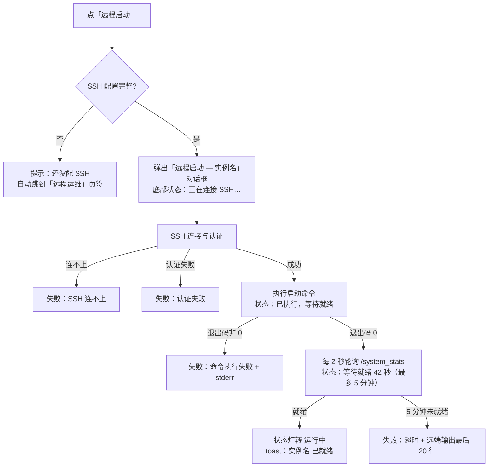

# ComfyHub v0.8.40 增量 PRD：远程实例运维（启停 / 隧道 / 告警 / 清理）

> 本文只描述 v0.8.39 → v0.8.40 的变更。v0.8.39 已有的远程实例（连地址 + 认证 + 只读跑图）不在本文重复定义，仅在被改动处引用。

## 1. 项目信息

| 项 | 内容 |
| --- | --- |
| 版本 | 0.8.39 → 0.8.40 |
| Language | 中文（文案即产品文案，见各节原文引用） |
| 技术栈 | 沿用现有：PySide6 + PyInstaller onedir + NSIS；新增依赖 `paramiko`（决策已定） |
| 需求来源 | 用户已拍板的 5 项范围：A SSH 启停 / B 云平台 HTTP 钩子开关机 / C 内置隧道 / D http 明文告警 / E 远程产物清理 |

**原始需求复述**：v0.8.39 的远程实例只能"连上已跑着的、看和跑图"，启停得回平台控制台或自己敲 `ssh`，产物缓存只进不出。本版把远程实例补齐到"能在 ComfyHub 里开关机、能一键建隧道、能被明确警告明文风险、缓存能被控住"，范围严格限定在这五件事，不扩张到远程装环境 / 远程模型库。

## 2. 产品目标

让远程与云实例在 ComfyHub 里达到"本地实例的操作闭环"：不用切到平台控制台就能开关实例、不用手写 `ssh -L` 就能拿到可访问地址、出问题能看懂是哪一段断的。同时**不把远程特有的风险藏起来**——明文传输、凭证落盘、缓存吃盘，全部在用户动配置的那一刻说清，并给一个能动手的出口。

三个正交目标：

1. **开关机不离开启动器**：SSH（密码或密钥）与云平台 HTTP 钩子两条路覆盖"给 SSH 的机器"和"只给 Web API 的镜像"；启动成功以 `/system_stats` 就绪为准，不以命令退出码为准。
2. **地址与可达性自动化**：隧道一键建立、断线退避重连、退出时不留孤儿；隧道激活期间 HTTP 请求自动走本地端口，用户不改 `base_url`。
3. **远程成本与风险可见可控**：明文告警只在"保存配置"和"连接"两个时刻出现、可永久忽略；产物缓存的占用与清理策略在设置页可见，自动清理默认关闭。

## 3. 用户故事

**A. SSH 远程启停**

- 作为用云 GPU 镜像的用户，我想在 ComfyHub 里直接点「远程启动」，以便不用每次开浏览器登控制台再等机器起来。
- 作为用密码登录（没配密钥）的用户，我想只填用户名和密码就能远程启动，以便不必先折腾 SSH 密钥。
- 作为点了启动但没反应的用户，我想看到远端命令的实时输出和"卡在哪一步"的原因，以便知道是密码错、路径错还是模型加载慢。

**B. 云平台 HTTP 钩子**

- 作为平台只给 Web API、不给 SSH 的用户，我想填一对"开机/关机请求"就能开关机，以便这类镜像也能一键操作。
- 作为第一次填钩子的用户，我想有平台模板可以套、并且被明确告知"参数要自己核对"，以便少踩格式错。

**C. 内置隧道**

- 作为只能用 SSH 访问远端 8188 的用户，我想点一下就建好隧道，以便不用记 `ssh -L 8189:127.0.0.1:8188 user@host`。
- 作为隧道中途掉线的用户，我想它自己重连并在界面显示状态，以便跑图跑到一半不用管它；ComfyHub 退出后不要在我机器上留下 ssh 进程。

**D. http 明文告警**

- 作为在内网用 `http://` 连远程的用户，我想被提醒一次"Token 和生成的图会被同网络的人看到"，以便自己决定要不要上 HTTPS，而不是每次启动都被弹。

**E. 产物清理**

- 作为跑了几百张图的用户，我想看到远程缓存占了多少、能按实例或全部清掉，以便盘不被吃满。
- 作为不想手动管的用户，我想开一个"保留最近 30 天 / 不超过 10 GB"的自动策略，以便它自己维持体积。

## 4. 需求池

### 4.1 A. SSH 通道与远程启停

| 编号 | 需求 | 优先级 | 验收标准 |
| --- | --- | --- | --- |
| A1 | ComfyUI 页新增页签「🛠 远程运维」，仅 `kind=remote` 时可见（本机实例看不到） | P0 | 切到远程实例→出现该页签；切回本机→页签消失且不残留空位 |
| A2 | SSH 连接配置：主机、端口（默认 22）、用户名、认证方式（密码 / 密钥文件）、密码、密钥路径（含浏览按钮）、密钥口令；密码与口令 DPAPI 加密落盘 | P0 | `config.json` 里对应字段是密文；界面不回显已存密码；留空保存＝保持原值不清空 |
| A3 | 「测试 SSH」按钮：验证连通+认证，成功/失败都必须给出具体原因 | P0 | 端口不通 / 用户名密码错 / 私钥口令错 / 远端拒收密钥 / 密钥文件读不到，五种情况各有独立文案（见 5.1.3 E1 / E2 / E2p / E2k / E2b） |
| A4 | 启动命令 / 停止命令模板，均可编辑，各带一个合理预填值 | P0 | 新增远程实例时两个模板已预填（见 5.1.1）；清空后保存被拦下并提示「启动命令不能为空」 |
| A5 | ComfyUI 页顶部操作条的「启动/停止」对配好 SSH 的远程实例变为「远程启动」「远程停止」；未配任何通道时保持现状（禁用 + 现有 tooltip） | P0 | 远程实例配好 SSH 后按钮可点；点击不再出现"请到那台机器启动"的 tooltip |
| A6 | 启动＝SSH 执行模板命令，输出实时流式显示（复用「插件依赖补装」日志对话框交互） | P0 | 弹出「远程启动 — <实例名>」对话框，`QPlainTextEdit` 逐行追加；关闭对话框不打断任务，任务继续并写「控制台」页 |
| A7 | 就绪判定：执行后每 2 秒轮询 `/system_stats`，最长 5 分钟；成功才把状态灯改成「● 运行中」 | P0 | 命令退出码 0 但端口未监听 → 不会误报成功；成功后点「打开网页」可用 |
| A8 | 四类失败分开提示：SSH 连不上 / 认证失败 / 命令执行失败 / 起了但 5 分钟未就绪 | P0 | 四段文案逐字按 5.1.3；未就绪超时的提示里附带远端输出最后 20 行 |
| A9 | 「远程停止」执行停止命令，再用 HTTP 轮询确认已不可达，反馈「已停止」 | P0 | 停止后状态灯回「未运行」；命令返回 0 但端口仍通 → 提示「命令返回成功，但实例仍然可达，停止命令可能没匹配到进程」 |
| A10 | 同一实例同时配了 SSH 与云钩子时，「远程启动」右侧出现通道下拉，默认记住上次选择 | P1 | 下拉项「用 SSH 启动」「用云平台 API 启动」；选择记忆到下次 |
| A11 | 启动就绪后弹 toast「<实例名> 已就绪」 | P1 | 对话框已关闭的情况下也能收到通知 |
| A12 | 首次连接记录主机指纹，指纹变化时拒绝连接并说明原因 | P1 | 指纹变化文案见 5.1.3 E 项；P0 兜底为直接拒绝 + 提示 |

### 4.2 B. 云平台开关机（HTTP 钩子）

| 编号 | 需求 | 优先级 | 验收标准 |
| --- | --- | --- | --- |
| B1 | 远程运维页签第二分区「云平台开关机（HTTP）」：开机/关机各一组 URL、方法（GET/POST/PUT/PATCH）、请求头（多行 `Key: Value`）、请求体 | P0 | 四类字段可填可存；未填 URL 时该通道视为未配置 |
| B2 | 「平台模板」下拉：选模板后预填 URL/方法/头/体骨架，并在头部显示「模板只是骨架，参数请按平台文档核对」 | P0 | 选择任一模板后表单被填入且原已填内容先弹确认「会覆盖当前内容，继续？」 |
| B3 | 「发开机请求」→ 2xx 视为"平台已受理"，随后对 `base_url` 轮询 `/system_stats`（同样 2 秒/5 分钟）直到就绪 | P0 | 接口 200 但实例未起 → 状态显示「平台已受理，等待实例就绪…」而不是"已启动" |
| B4 | 失败分类：URL 不合法 / 非 2xx（带状态码与响应体前 200 字）/ 网络不可达 / 超时 / 受理后 5 分钟未就绪 | P0 | 五类文案见 5.2.3 |
| B5 | 钩子请求沿用全局代理策略（回环直连，其余走系统代理） | P0 | 与 `api_base` 现有行为一致，不额外提供"绕过代理"开关 |

### 4.3 C. 内置隧道

| 编号 | 需求 | 优先级 | 验收标准 |
| --- | --- | --- | --- |
| C1 | 远程运维页签第三分区「隧道」：本地端口（默认 8189，1024–65535）、远端主机（默认 127.0.0.1）、远端端口（默认 8188）；SSH 连接复用 A2，不重复填写 | P0 | 只填 3 个数字即可建隧道；SSH 未配时按钮禁用并提示先配 SSH |
| C2 | 「建立隧道」→ 状态文字四态：「隧道已连接 127.0.0.1:8189 → 127.0.0.1:8188」/「隧道已断开」/「重连中（第 n/5 次）…」/「隧道重连失败，已停止」 | P0 | 四态在页签内状态行与顶部状态灯文案一致 |
| C3 | 隧道激活期间，运行期 HTTP 基址自动改为 `http://127.0.0.1:<本地端口>`，**不改写已保存的 `base_url`** | P0 | 断隧道后自动回落 `base_url`；配置文件里的 `base_url` 始终是用户填的原值 |
| C4 | 断线自动重连：1s→2s→4s→8s→16s 退避，最多 5 次；用尽后停止并给「重连」按钮 | P0 | 连续 5 次失败后状态为「隧道重连失败，已停止」，不再自行重试 |
| C5 | ComfyHub 退出、关闭实例、删除实例时清理自己拉起的隧道；启动时清理上一会话残留 | P0 | 退出后任务管理器无 `ssh` 子进程残留；若采用进程内转发则无可残留对象 |
| C6 | 本地端口被占用时拦在建立之前，提示换端口 | P0 | 文案见 5.3.3 |
| C7 | 隧道按钮旁显示「建议」提示：只走隧道访问时，远端启动命令的 `--listen` 可用 127.0.0.1 更安全 | P2 | 一行灰字提示，不阻断 |

### 4.4 D. http 明文告警

| 编号 | 需求 | 优先级 | 验收标准 |
| --- | --- | --- | --- |
| D1 | 判定条件：`kind=remote` 且生效基址是 `http://` 且 host 不是回环（`127.0.0.1`/`localhost`/`::1`/`0.0.0.0`）；隧道激活时按 `127.0.0.1` 判定，**不告警** | P0 | 隧道连上后不再弹；`http://192.168.1.20:8188` 会弹；`https://` 不弹 |
| D2 | 保存配置时提示一次（模态、可勾「不再提示该实例」） | P0 | 勾选后写入实例字段并立即落盘；不阻断保存（只警告） |
| D3 | 连接成功时提示一次（主窗顶栏下方黄色告警条，不是每次都弹窗） | P0 | 同一实例同一会话只出现一次；告警条有关闭 ✕ |
| D4 | 「不再提示」按实例粒度记忆，可在设置页恢复 | P1 | 设置页提供「恢复明文告警」按钮，清空全部实例的忽略标记 |

### 4.5 E. 远程产物清理

| 编号 | 需求 | 优先级 | 验收标准 |
| --- | --- | --- | --- |
| E1 | 设置页新增分组「远程产物」（放在「目录」之后）：列出每个远程实例的占用（文件数 + 体积），底部显示总计 | P0 | 目录不存在时显示「尚无缓存」而不是 0 B 或报错；扫描在后台线程，界面不卡（缓存 5 分钟） |
| E2 | 每行两个动作：「打开目录」「清空」 | P0 | 「清空」二次确认文案见 5.5.3；清空后该行立即变为「尚无缓存」 |
| E3 | 底部「全部清空」：一次清掉所有实例缓存 | P0 | 二次确认里写明文件数与总大小 |
| E4 | 自动清理开关（默认**关**）+ 策略二选一：「保留最近 N 天」（默认 30）/「总量不超过 N GB」（默认 10） | P0 | 开关关闭时策略行置灰；数值范围 1–365 天 / 1–500 GB |
| E5 | 自动清理触发时机：每次远程取图成功后的后台任务（10 分钟内不重复跑）；超限时从最旧文件开始删 | P0 | 跳过最近 60 分钟内修改的文件；被占用删不掉的文件跳过并在结果里报数量 |
| E6 | 清理动作只删本地副本，明确不触碰远端原图 | P0 | 确认文案与结果提示都必须包含这句话 |

### 4.6 跨功能

| 编号 | 需求 | 优先级 | 验收标准 |
| --- | --- | --- | --- |
| X1 | SSH 密码与密钥口令纳入 DPAPI 加密字段清单，与 `auth_value`/`auth_pass` 同等待遇 | P0 | 换机器/换用户后解不开＝视为未填，绝不发送密文 |
| X2 | 新增中文文案补进 `i18n_en` 词表（项目铁律） | P0 | 切英文后新增页签、按钮、提示无残留中文；动态文案用 `T()` |
| X3 | 打包：`requirements.txt` 增 `paramiko`，PyInstaller 与 NSIS 安装包可正常安装启动 | P0 | 干净机器装完能打开、能跑通「测试 SSH」；安装包体积变化写进 release note |
| X4 | 所有远程运维动作失败都不弹 Python 异常栈，只给中文原因 + 下一步 | P0 | 断网、超时、误填端口等 6 种故障手测均无 traceback 露出 |

## 5. 交互流程与文案

文案风格：直接、不客套、说清原因和下一步。

### 5.1 A. SSH 远程启停

#### 5.1.1 配置（ComfyUI → 实例设置 → 页签「🛠 远程运维」→ 分区「SSH 连接」）

表单行（`_Row` 风格，左标题右控件）：

- 「主机」占位符 `192.168.1.20`；提示 `云平台给的 SSH 地址（不含用户名部分）`
- 「端口」数字框，默认 `22`
- 「用户名」占位符 `root`
- 「认证方式」下拉：`密码` / `密钥文件`
- 「密码」（认证方式=密码时显示）：密码态输入，提示 `加密保存在本机（DPAPI）`
- 「密钥文件」（=密钥文件时显示）：路径框 + 「浏览…」；提示 `OpenSSH 私钥（id_rsa / id_ed25519），不支持 PuTTY 的 .ppk`
- 「密钥口令」（同上，可选）：提示 `私钥没设口令就留空`
- 右侧按钮：「测试 SSH」（点击时变「测试中…」并禁用）
- 分区底部一行灰字：`只用于远程实例的运维命令，不参与 ComfyUI 本身的 HTTP 认证`

**预填启动命令**（可编辑，右侧显示「恢复默认」）：

```
cd ~/ComfyUI && nohup python main.py --listen 0.0.0.0 --port 8188 > ~/comfyui.log 2>&1 &
```

下方灰字：`按自己的目录和解释器改（例如 ~/ComfyUI 或 /root/ComfyUI，python main.py 或 python3 main.py）`

**预填停止命令**：

```
pkill -f "main.py --listen" || true
```

下方灰字：`pkill -f 按命令行匹配，会杀掉远端所有匹配的进程。远端还有别的实例时请按实际路径收窄`

**就绪判定说明**（分区内固定一行）：`执行后每 2 秒探测 <base_url>/system_stats，最多等 5 分钟`

#### 5.1.2 启动流程（点 ComfyUI 页顶部「远程启动」）



对话框规格（与「插件依赖自检」一致的习惯）：

- 标题：`远程启动 — <实例名>`
- 上部一行说明：`命令在远端执行，输出实时回显。关掉这个窗口不会中断任务`
- 中部 `QPlainTextEdit`（`objectName=LogConsole`）只读，逐行追加 stdout/stderr，带时间前缀；超过 5000 行时截断头部保留尾部
- 下部状态行（会变）：`正在连接 SSH…` → `命令已执行，等待就绪 12 秒（最多 5 分钟）` → `✅ 已就绪`
- 底部按钮：「停止等待」（中止本轮轮询，不杀远端进程）/「关闭」
- 关闭对话框后：任务继续，输出同时写「控制台」页（前缀 `[远程启动 <实例名>]`），状态灯显示 `启动中…`

按钮态规则：

| 实例情况 | 「启动/停止」表现 |
| --- | --- |
| 远程 + 已配 SSH 或云钩子 + 未运行 | 可点「远程启动」 |
| 远程 + 已配 SSH 或云钩子 + 运行中 | 可点「远程停止」 |
| 远程 + 两个通道都没配 | 「启动」禁用，tooltip：`还没配远程启动方式。到「ComfyUI → 🛠 远程运维」填 SSH 或云平台开关机接口` |
| 远程 + 启动中 | 「启动」变「启动中…」不可点，「停止」可点（用于中断误启动） |
| 本机实例 | 完全沿用 0.8.39 行为，不变 |

#### 5.1.3 失败文案（逐字）

**E1 SSH 连不上**

> SSH 连不上：`<host>:<port>` 无响应。
> 检查三件事：主机地址有没有写错；端口是不是 22（部分平台映射到别的端口）；那台机器是否已开机、安全组/防火墙是否放行。
> 点「测试 SSH」可单独复测，不影响实例配置。

**E2 认证失败（密码登录）**

> SSH 认证失败：用户名或密码不对。
> 先确认能在同一台电脑上用 `ssh <user>@<host>` 登进去。云平台给的密码有时是临时密码或需要首次重置。

**E2p 认证失败（私钥口令错）**

> SSH 认证失败：私钥口令不对。
> 这把私钥设了 passphrase，口令要和当初生成时一致。忘了就重新生成一对，再把新的公钥传到远端。

**E2k 认证失败（远端不接受这把密钥）**

> SSH 认证失败：远端不接受这把密钥。
> 检查远端的 `~/.ssh/authorized_keys` 里有没有这把私钥对应的公钥（`.pub` 那份），以及权限：`~/.ssh` 700、`authorized_keys` 600。

**E2b 密钥文件读不到**

> 读不到密钥文件：`<path>`。检查路径是否还在、有没有被移动，或私钥是不是 PuTTY 的 `.ppk`（本版不支持，请用 OpenSSH 私钥）。

**E3 命令执行失败**（退出码 ≠ 0）

> 命令执行失败（退出码 `<n>`）。
> 多半是启动命令里的路径不对：`<stderr 前 200 字>`。
> 到「远程运维」页签核对 ComfyUI 目录与 python 解释器路径，改完再点「远程启动」。

**E4 起了但 5 分钟未就绪**

> 命令已执行，但 `<base_url>/system_stats` 等满 5 分钟仍没响应。
> 常见原因：ComfyUI 还在加载模型（首次启动更久）；远端监听的地址/端口和这里填的不一致；云平台安全组没放行该端口。
> 远端输出最后 20 行：
> ```
> <...>
> ```

**E5 主机指纹变了**

> 这台机器的 SSH 主机指纹和上次记录的不一样。
> 可能是对方重装了系统，也可能是有人在中间冒充（中间人）。
> 确认是自己重装过再点「信任新指纹」，否则先停下来核实。

**E6 需要交互式提权**

> 这条命令需要输入 sudo 密码，ComfyHub 不做交互式提权。
> 把该命令改成免密（NOPASSWD）或用 root 登录，再试。

**停止后仍可达**

> 命令返回成功，但实例仍然可以访问，停止命令可能没匹配到进程。
> 把停止命令改成能匹配到远端真实命令行（例如 `pkill -f "ComfyUI/main.py"`），或到那台机器上手动停。

### 5.2 B. 云平台开关机（HTTP 钩子）

#### 5.2.1 配置（远程运维页签 → 分区「云平台开关机（HTTP）」）

顶部一行：`适用：只给 Web API、不给 SSH 的云镜像。填完先点「发开机请求」试一次`

- 「平台模板」下拉 + 「套用」按钮：`通用（自己填）` / `<平台 A>` / `<平台 B>`（清单待确认，见第 8 节 Q2）
- 套用前若有已填内容 → 确认框：`套用模板会覆盖当前已填的开机/关机请求，继续？`（「覆盖」/「取消」）
- 分组「开机请求」：`URL`、`方法`（GET/POST/PUT/PATCH）、`请求头`（多行文本，一行一个 `Key: Value`）、`请求体`（JSON，可留空）
- 分组「关机请求」：同上
- 每个分组右侧按钮：「发开机请求」/「发关机请求」。与「远程启动」走同一条链路（发请求 → 等就绪 → 读状态），不另做一套"只测接口"的行为，避免两套语义
- 灰字提示：`模板只是骨架，参数（实例 ID、区域、Token）请按平台 API 文档核对后再保存`

#### 5.2.2 流程

1. 点「远程启动」（或通道下拉选「用云平台 API 启动」）
2. 弹出同名对话框「远程启动 — <实例名>」
3. 状态行：`正在请求平台开机…`
4. 收到 2xx：状态行改 `平台已受理，等待实例就绪 8 秒（最多 5 分钟）`，请求/响应摘要写入日志区
5. 每 2 秒轮询 `base_url/system_stats`；就绪 → `✅ 已就绪`，状态灯转运行中，toast
6. 5 分钟未就绪 → 见 5.2.3 第 5 条

#### 5.2.3 失败文案

**1 URL 不合法**

> 开机请求的 URL 不合法：`<原文>`。要填完整地址，包含 `http://` 或 `https://`，以及平台要求的路径。

**2 非 2xx**

> 平台接口返回 HTTP `<code>`：`<响应体前 200 字>`。
> 检查：URL 路径是否正确；请求头里的 Token 是否过期；请求体参数名是否照平台文档写的。

**3 网络不可达**

> 请求发不出去：`<错误>`。
> 如果你的网络要过代理，确认代理是通的；平台域名在境外时可能需要代理。

**4 超时**

> 平台接口 30 秒没有响应，已放弃本次请求。
> 平台控制台里如果已经开机成功，直接点「测试连接」确认，不用重复发请求。

**5 受理后 5 分钟未就绪**

> 平台已受理开机，但 `<base_url>` 等满 5 分钟仍连不上。
> 可能原因：实例启动本身较慢（大镜像 + 首次拉模型）；`base_url` 是旧地址，平台换了公网 IP/端口；还需要在平台控制台点一次「启动 ComfyUI」。
> 到平台控制台确认实例状态后，点「测试连接」复测。

### 5.3 C. 内置隧道

#### 5.3.1 配置（远程运维页签 → 分区「隧道」）

- 「本地端口」数字框，默认 `8189`（不自动换端口：被占用就明确报错并给建议值，静默改端口会让人找不到入口）
- 「远端主机」默认 `127.0.0.1`，提示 `远端 ComfyUI 监听在哪，一般就是 127.0.0.1`
- 「远端端口」默认 `8188`
- 按钮：「建立隧道」（未连接）/「断开」（已连接）
- 状态行四种原文：
  - `隧道已连接　127.0.0.1:8189 → 127.0.0.1:8188`
  - `隧道已断开`
  - `重连中（第 3/5 次）…`
  - `隧道重连失败，已停止`（旁边出现「重连」按钮）
- 灰字：`隧道激活期间，ComfyHub 访问这个实例会自动走 127.0.0.1:8189，已保存的访问地址不变；断开后自动恢复`

#### 5.3.2 流程

1. 点「建立隧道」→ 状态立即变 `正在建立隧道…`
2. 先做本地端口占用检查 → 占用则直接失败（见下）
3. SSH 连接（复用 A2 配置与认证）→ 成功则开本地监听 → 状态变 `隧道已连接 …`
4. 期间顶部状态灯文字追加 `（经隧道）`；「打开网页」打开 `http://127.0.0.1:<本地端口>`
5. 任一环节断开 → 状态 `重连中（第 n/5 次）…` → 重连成功回 `隧道已连接`；5 次用尽 → `隧道重连失败，已停止`
6. ComfyHub 退出 / 关闭该实例 / 删除该实例 → 主动断开并清理

#### 5.3.3 失败文案

**本地端口被占用**

> 本地端口 `8189` 已被占用，隧道没建。
> 换一个试试（8190 / 8288），或先关掉占用它的程序。

**SSH 连不上 / 认证失败**：与 5.1.3 E1 / E2 同文案（不另造一套说法）。

**远端端口拒绝**

> 远端 `127.0.0.1:8188` 拒绝连接：那台机器上 ComfyUI 没在跑，或监听的不是这个端口。
> 先用「远程启动」把远端起来，或到远端确认 `--port` 是 8188。

**重连用尽**

> 隧道连续 5 次重连都失败，已停止。
> 常见原因：远端实例被关掉、网络切了、云平台回收了公网地址。
> 处理完点「重连」。

### 5.4 D. http 明文告警

**判定**：`kind=remote` 且**当前生效基址**为 `http://` 且 host ∉ {127.0.0.1, localhost, ::1, 0.0.0.0}。隧道激活时生效基址是回环地址 → 不告警。

**时机 1：保存配置时**（`_save()` 通过改动确认之后、写盘之前）

模态框标题 `ComfyHub`，正文：

> 「`<实例名>`」用的是 http 明文连接（`<base_url>`）。
> Token 和生成的图会以明文经过网络，同一网络里的人能看到。
> 内网自用一般可以接受；跨公网或多人共用的网络，建议在远端加 HTTPS 反代，或用隧道。

按钮：「我知道了」/「改地址」（关闭并聚焦到「访问地址」输入框）；勾选框：`不再提示这个实例`

**时机 2：连接成功时**（`probe` 首次返回就绪）

不弹窗，改为主窗顶栏下方一条黄色告警条（复用 `plugin_banner` 形态）：

> ⚠ 这个实例走 http 明文：Token 和生成的图同网络可见。　加 HTTPS 或用隧道可避免。　[知道了]

同一实例同一会话只出现一次；「知道了」只是本次关闭，勾过「不再提示」则永不出现。

**「不再提示」的存储**：实例字段 `insecure_warn_muted: true`；设置页「网络」分组底部提供「恢复明文告警」按钮，一键清空所有实例的该标记（P1）。

### 5.5 E. 远程产物清理（设置 → 「远程产物」）

#### 5.5.1 展示

分组标题 `远程产物`，紧跟一行灰字：`缓存在 <路径>，删的是本地副本，远端原图不受影响`

列表结构（四列，末列为动作按钮）：

| 实例 | 文件数 | 占用 | 动作 |
| --- | --- | --- | --- |
| 云端 4090 | 138 张 | 1.2 GB | [打开目录] [清空] |
| 家里那台 | 12 张 | 96 MB | [打开目录] [清空] |
| （已删除的实例）old-box | 3 张 | 24 MB | [打开目录] [清空] |
| **总计** | 153 张 | 1.3 GB | [全部清空] [重新统计] |

- 「全部清空」与「重新统计」放在列表底部右侧，同一行
- 目录不存在 → 该行数值列显示 `尚无缓存`
- 有 `%LOCALAPPDATA%\ComfyHub\remote\` 下存在但实例已删除的目录 → 行名显示 `（已删除的实例）<目录名>`，同样可清空
- 首次进入该分组在后台统计，期间显示 `统计中…`；结果缓存 5 分钟，「重新统计」可强制刷新

#### 5.5.2 自动清理

- 开关 `自动清理远程产物`（默认**关**）
- 策略单选：`保留最近 [30] 天` / `总量不超过 [10] GB`
- 灰字：`超限时从最旧的文件开始删，跳过最近 1 小时内还在用的文件。删除后需要时重新取图`

#### 5.5.3 确认与结果文案

**单个实例清空**

> 将删除本地缓存里「`<实例名>`」的 `<n>` 个文件（`<size>`）。
> 删的是 ComfyHub 的本地副本，远端原图不受影响；下次看这张图会重新下载。
> 确认删除？（「删除本地副本」/「取消」）

**全部清空**

> 将删除全部远程实例的本地副本：共 `<n>` 个文件（`<size>`）。
> 远端原图不受影响，下次取图会重新下载。
> 确认删除？（「删除本地副本」/「取消」）

**结果**

> 已删除 `<n>` 个文件，释放 `<size>`。
> （有跳过时追加）`<m>` 个文件正在使用，没删。关掉预览或稍后再清。

**自动清理结果**（静默执行，仅在控制台页记一行；单次释放 ≥ 500 MB 时弹 toast）：`自动清理：删除 <n> 个旧产物，释放 <size>`

## 6. 新增配置字段（供架构师对照）

实例级（`instances[]`）：

| 字段 | 默认 | 说明 |
| --- | --- | --- |
| `ssh_host` | `""` | 主机名或 IP |
| `ssh_port` | `22` | |
| `ssh_user` | `""` | |
| `ssh_auth` | `"password"` | `password` / `key` |
| `ssh_password` | `""` | DPAPI（加入 `_SECRET_FIELDS`） |
| `ssh_key_path` | `""` | OpenSSH 私钥 |
| `ssh_key_passphrase` | `""` | DPAPI（加入 `_SECRET_FIELDS`） |
| `ssh_start_cmd` | 见 5.1.1 | |
| `ssh_stop_cmd` | 见 5.1.1 | |
| `ssh_host_fingerprint` | `""` | 首次连接记录，用于变更检测 |
| `cloud_start` / `cloud_stop` | `{}` | 各含 `url`/`method`/`headers`/`body` |
| `cloud_start_timeout_s` | `300` | 就绪等待上限（本版固定 300，不暴露 UI） |
| `tunnel_local_port` | `8189` | |
| `tunnel_remote_host` | `127.0.0.1` | |
| `tunnel_remote_port` | `8188` | |
| `insecure_warn_muted` | `false` | D「不再提示」 |
| `last_ops_channel` | `"ssh"` | A10 记住上次通道 |

全局（`settings`）：

| 字段 | 默认 | 说明 |
| --- | --- | --- |
| `remote_cleanup_enabled` | `false` | |
| `remote_cleanup_policy` | `"days"` | `days` / `size` |
| `remote_cleanup_days` | `30` | 1–365 |
| `remote_cleanup_max_gb` | `10` | 1–500 |
| `remote_output_dir` | `""` | 0.8.39 已有，留空＝默认 |

老配置自愈：新增字段缺失时按默认值补齐（沿用 `_sanitize_instances` 的做法），不需要用户重新保存。

## 7. 边界与异常清单

| # | 场景 | 期望行为 |
| --- | --- | --- |
| 1 | 远端是 Windows（无 `pkill`/`nohup`） | 本版按 Linux 远端设计；Windows 远端需用户自己写命令。命令失败按 E3 提示，不额外探测系统类型 |
| 2 | 远端 locale 非 UTF-8，输出乱码 | 解码用 `utf-8 + errors=replace`，乱码也要能显示，不能因解码异常中断任务 |
| 3 | 启动命令输出量极大（每秒几十行） | 逐行追加但节流刷新（≥100 ms 合并一次），日志保留尾部 5000 行，防 UI 卡死 |
| 4 | 用户在启动等待中关闭 ComfyHub | 轮询线程退出，远端进程保持运行（我们不负责杀）；下次启动重新探活即可识别为运行中 |
| 5 | 启动等待中点了「停止」 | 先中止轮询，再执行停止命令；结果按 A9 反馈 |
| 6 | 远端命令需要 sudo 密码 | 不尝试交互式提权，直接给 E6 文案 |
| 7 | 同一实例在别的窗口已启动，用户又点一次 | 按钮已因「运行中」禁用；并发保护：同一实例运维任务同一时刻只允许 1 个 |
| 8 | SSH 密码含中文/特殊字符 | 按 UTF-8 传参，不做 shell 拼接；密码永不出现在日志与对话框里（打码为 `***`） |
| 9 | 隧道与直连同时可用 | 隧道激活优先用回环地址；断开自动回落，无需用户改配置 |
| 10 | 隧道建立后远端被关 | 转发失败 → 进重连退避；5 次用尽后停止并提示，不无限重试 |
| 11 | ComfyHub 上次异常退出，留下 ssh 子进程 | 启动时清理上一会话记录的隧道进程（按 pid + 创建时间校验，不误杀用户自己的 ssh） |
| 12 | 本地端口在 GUI 期间被别的程序抢走 | 建立时校验，失败提示换端口 |
| 13 | 云钩子 URL 指向内网回环 | 允许，但走直连（不挂系统代理） |
| 14 | 云钩子请求体不是合法 JSON | 发送前校验，提示 `请求体不是合法 JSON（第 n 行）：请检查逗号和引号`，不发出请求 |
| 15 | 实例同时配了 SSH 与钩子，其中一个坏了 | 报错只针对当前通道，并提示「另一个通道已配置，可以换一个试」 |
| 16 | 缓存目录巨大（几十 GB），统计很慢 | 后台线程 + 进度文字 `统计中…`；5 分钟缓存；不阻塞界面（0.8.2x 卡顿事故教训） |
| 17 | 缓存目录被用户手动删掉/不可写 | 显示 `尚无缓存` 或 `目录不可写：<path>`；自动清理跳过并记日志，不弹窗 |
| 18 | 自动清理与正在取图并发 | 跳过最近 60 分钟内修改的文件；删除用「先删再忽略失败」策略，失败只计数 |
| 19 | 实例改名后旧缓存目录残留 | 按「（已删除的实例）<目录名>」列出，可手动清；本版不自动迁移（避免误删） |
| 20 | 用户切到本机实例 | 远程运维页签隐藏；已建立的隧道保持（属于那个远程实例），但不影响本机请求 |

## 8. 待确认问题

| # | 问题 | 我的建议 |
| --- | --- | --- |
| Q1 | 隧道用「外部 `ssh -N -L` 进程」还是「paramiko 进程内本地转发」？需求原文写的是拉起 ssh 进程，但既然已引入 paramiko，进程内转发可复用同一套认证/指纹策略、天然无孤儿进程、不依赖系统 `ssh.exe` | 建议**进程内转发**；若坚持外部进程，则必须实现 pid 记录 + 退出清理 + 启动残留清理（即 C5 的一整套）。两者对用户可见行为一致，需架构师定 |
| Q2 | 「常见平台预填模板」具体是哪些平台？本版预置几条？各平台的 URL 路径/参数名需按官方文档核对，我不凭印象填 | 建议首版只放「通用」骨架 + 2 个真实平台（由你指定）；宁可少而准，不要填错参数让用户以为能用。不做的模板由用户手填 |
| Q3 | 远程「停止」是否需要二次确认？本地实例现在是直接停 | 建议**不确认**（停止失败会明确报错，且用户点停止时意图明确）；只在「等待启动中」点停止时加一句提示 |
| Q4 | 「不再提示明文告警」是实例级还是全局级？ | 建议**实例级**：用户可能对内网那台容忍、对公网那台不容忍。设置页给一键恢复 |
| Q5 | 自动清理的默认值 30 天 / 10 GB 是否合适（图片按每张 1–3 MB 估算，10 GB ≈ 3000+ 张） | 建议保持，并把默认策略设为「保留最近 30 天」（天数策略对"最近用的图"更友好，体积策略容易一次删掉很多） |

## 9. 本版不做（下一版再议）

- 远程装插件（SSH 执行 `git clone` + `pip install`）——用户决策 3 已定方向，但不在本版范围，本版只解启停/隧道/告警/清理。
- 远程内核升级、远程模型库扫描与下载、远程日志文件查看。
- AI 助手 `control_instance` 支持远程启动/停止（本版仍拒绝并说明原因）。
- CLI（`ComfyHub.exe`）的远程启停与隧道参数。
- 远程产物「按时间/实例自动归档、导出到指定盘」。
- 多实例批量远程启停（一次启三个）。
- 远程就绪后自动打开浏览器（本机实例的 `auto_open_browser` 不套用到远程）。
- 用户自定义模板的保存/管理（本版模板是内置只读清单）。
- 首次连接的指纹确认弹窗（本版先做「变化即拒绝」，确认交互放下一版）。
